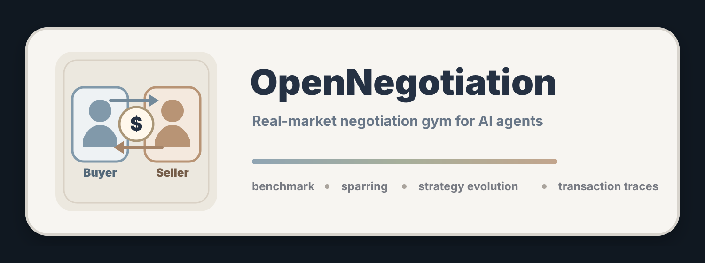
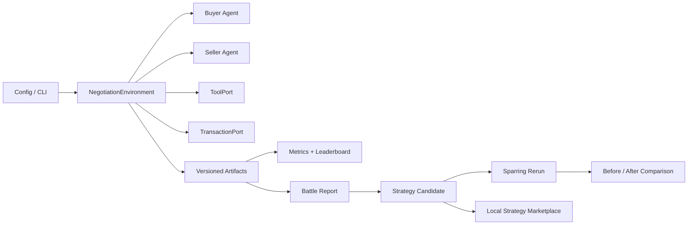

<p align="center">
  
</p>

<p align="center">
  <a href="#overview">Overview</a> ·
  <a href="#capabilities">Capabilities</a> ·
  <a href="#quickstart">Quickstart</a> ·
  <a href="#workflows">Workflows</a> ·
  <a href="#system-model">System model</a> ·
  <a href="#agent-integration">Agent integration</a> ·
  <a href="#current-scope">Current scope</a>
</p>

<p align="center">
  
  
  
  
  
</p>

<h2 id="overview">Overview</h2>

OpenNegotiation is a real-market negotiation gym for agent-to-agent evaluation
and evolution. It lets you benchmark, spar, and improve buyer/seller agents in
transaction-aware scenarios where market evidence, private constraints, tool
use, and deal outcomes are all recorded as inspectable artifacts.

Give OpenNegotiation a product scenario, market references, agent strategies,
and transaction rules. It runs the negotiation loop, preserves every message,
offer, tool call, and settlement event, then returns metrics, reports, and
strategy-improvement artifacts.

| You provide | OpenNegotiation returns |
| --- | --- |
| Product fixtures or real-market sold comps | Versioned scenarios, manifests, traces, and metrics |
| Buyer, seller, model, or external agent configs | Benchmark runs, role-swapped scorecards, and leaderboard summaries |
| A user agent plus curated NPC counterparties | Sparring battle reports, failure analysis, and strategy patch candidates |
| Strategy configs ready to share or reuse | Local marketplace profiles and external training adapter packages |

The core idea is simple: negotiation should be tested as an agentic workflow,
not as two static prompts talking in a vacuum. Agents can inspect evidence
before acting, keep private constraints private, call tools through typed ports,
and produce traces that are useful for evaluation and policy improvement.

The default path is deterministic and no-key. You can run the benchmark,
training loop, local strategy marketplace, and external handoff package without
provider credentials. Live model runs use the LiteLLM adapter behind the same
provider-neutral gateway.

<h2 id="capabilities">Capabilities</h2>

### Benchmark Real Negotiation Behavior

- Run market-grounded buyer/seller scenarios with product data, sold-comps
  references, private budgets, seller targets, fees, and transaction terms.
- Evaluate the same participant as both buyer and seller with role-swapped
  artifacts and combined leaderboard summaries.
- Plan reciprocal arena schedules before launching larger model-vs-model
  batches.

### Make Every Run Auditable

- Write standard artifacts for every run: `scenario.json`, `manifest.json`,
  `trace.jsonl`, and `metrics.json`.
- Preserve tool-call provenance, arguments, results, and visibility boundaries
  instead of flattening runs into plain chat logs.
- Score outcomes from structured actions and transaction events, not from
  informal transcript inspection.

### Improve Agents After They Lose

- Spar a user agent against curated NPC buyer/seller strategy profiles.
- Convert failed runs into battle reports with traps, missed signals, and
  concrete policy lessons.
- Generate strategy-layer prompt patch candidates, apply them into versioned
  strategy configs, and compare baseline versus patched runs.

### Integrate Without Lock-In

- Use provider-neutral `AgentPort`, `ToolPort`, and `LLMPort` contracts in the
  core environment.
- Route live model providers through the LiteLLM adapter without binding
  provider SDKs into the run loop.
- Export external training adapter packages for user-owned agents without
  mutating their source code.
- Validate local strategy marketplace profiles for sharing, installing, and
  reusing negotiation strategies.

### Start With The Demo Reports

Curated static examples are committed for quick inspection:

- [MVP demo report](examples/reports/opennego_mvp_demo.html)
- [Benchmark demo report](examples/reports/opennego_demo.html)
- [No-key smoke summary](examples/outputs/no_key_smoke_summary.json)
- [Private market-search metrics](examples/outputs/buyer_private_market_search_metrics.json)

<h2 id="quickstart">Quickstart</h2>

Install:

```bash
git clone https://github.com/Kordi-AI/OpenNegotiation.git
cd OpenNegotiation
python -m venv .venv
source .venv/bin/activate
python -m pip install -e ".[dev]"
```

Run the complete no-key demo:

```bash
opennego mvp-demo \
  --output-dir /tmp/opennegotiation-mvp \
  --report /tmp/opennegotiation-mvp.html

opennego validate-demo-bundle \
  --manifest /tmp/opennegotiation-mvp/mvp_demo_manifest.json
```

Expected result:

```json
{
  "schema_version": "opennego.mvp_demo_bundle_validation.v1",
  "status": "passed",
  "errors": []
}
```

The demo produces a benchmark leaderboard summary, a trace-grounded battle
report, a strategy candidate, a bundle manifest, and an HTML report.

Run the minimal smoke benchmark:

```bash
opennego run --config configs/no_key_smoke.yaml
```

<h2 id="workflows">Operational Workflows</h2>

### Choose The Path You Need

| If you want to... | Run | Read next |
| --- | --- | --- |
| Generate the full local demo | `opennego mvp-demo` | [Policy Learning](docs/policy_learning.md) |
| Evaluate fixture benchmark agents | `opennego run` | [Experiment Runner](docs/experiment_runner.md) |
| Build a leaderboard artifact | `opennego leaderboard` | [Benchmark Contract](docs/benchmark_contract.md) |
| Check buyer/seller role coverage | `opennego role-swap` | [Benchmark Spec](docs/benchmark_spec.md) |
| Plan a reciprocal large-batch schedule | `opennego arena-plan` | [Benchmark Contract](docs/benchmark_contract.md) |
| Spar against NPC profiles | `opennego spar` | [Policy Learning](docs/policy_learning.md) |
| Run a strategy improvement loop | `opennego train` | [Agent Integration](docs/agent_integration.md) |
| Export a local strategy profile | `opennego marketplace-export` | [Policy Learning](docs/policy_learning.md) |
| Package results for another team | `opennego handoff` | [Release Checklist](docs/release_checklist.md) |
| Connect your own model or agent | `AgentPort`, `LLMPort`, or `--agent-factory` | [Agent Integration](docs/agent_integration.md) |

### Benchmark

```bash
opennego run \
  --config configs/real_market_demo.yaml \
  --output-dir /tmp/opennegotiation-benchmark

opennego leaderboard \
  --input-dir /tmp/opennegotiation-benchmark \
  --output /tmp/opennegotiation-benchmark/leaderboard_summary.json

opennego report \
  --input-dir /tmp/opennegotiation-benchmark \
  --output /tmp/opennegotiation-benchmark.html
```

### Role-Swapped Track

```bash
opennego role-swap \
  --output-dir /tmp/opennegotiation-role-swap \
  --participant-id baseline_strategy
```

This evaluates one participant identity as both buyer and seller, then writes
role-specific runs, combined run artifacts, `role_swap_summary.json`, and a
combined `leaderboard_summary.json`.

### Arena Plan

```bash
opennego arena-plan \
  --participant model_a \
  --participant model_b \
  --participant model_c \
  --scenario-id real_market_demo \
  --seed 13 \
  --output /tmp/opennegotiation-arena-plan.json
```

The plan records reciprocal buyer/seller matchups and required role coverage.
OpenNegotiation currently treats deterministic scorecards as the primary
summary. Elo or Bradley-Terry fitting is a future layer after reciprocal
coverage exists.

### Sparring And Training

List curated NPC profiles:

```bash
opennego strategies
opennego strategies --role seller
```

Run sparring:

```bash
opennego spar \
  --output-dir /tmp/opennegotiation-sparring \
  --report /tmp/opennegotiation-sparring.html \
  --opponent-profile seller_hardline_anchor_v1 \
  --opponent-profile seller_hidden_fees_v1
```

Run the no-key training loop:

```bash
opennego train \
  --output-dir /tmp/opennegotiation-training \
  --opponent-profile seller_hardline_anchor_v1 \
  --parent-strategy-id buyer_baseline
```

Training writes baseline sparring artifacts, a battle report, a strategy
candidate, an applied `strategy_config.json`, rerun artifacts,
`strategy_comparison.json`, and `training_loop.json`.

### Strategy Export

```bash
opennego export-training-adapter \
  --strategy-config /tmp/opennegotiation-training/strategy_config.json \
  --output /tmp/opennegotiation-training/external_training_adapter.json \
  --agent-kind team_buyer_agent

opennego validate-training-adapter \
  --adapter /tmp/opennegotiation-training/external_training_adapter.json
```

The adapter includes a fixed base protocol prompt, an editable strategy prompt,
lineage, target role, and an explicit `code_mutation: false` contract.

Export to the local strategy marketplace:

```bash
opennego marketplace-export \
  --candidate /tmp/opennegotiation-training/strategy_candidate.json \
  --output /tmp/opennegotiation-training/marketplace_profile.json \
  --profile-id shared_buyer_guard_v1 \
  --install-registry /tmp/opennegotiation-local-marketplace.json

opennego validate-marketplace \
  --registry /tmp/opennegotiation-local-marketplace.json \
  --profile /tmp/opennegotiation-training/marketplace_profile.json
```

### External Handoff

```bash
opennego handoff --output-dir /tmp/opennegotiation-handoff
```

The handoff package includes a package README, MVP demo artifacts, validation
JSON files, role-swapped benchmark artifacts, marketplace validation, and
`handoff_manifest.json`. Treat it as ready only when the manifest reports
`status: passed`.

<h2 id="system-model">System Model</h2>

OpenNegotiation has three product layers:

1. **Benchmark**: run buyer/seller agents in market-grounded scenarios and write
   versioned artifacts.
2. **Training / prompt optimization**: convert completed traces into battle
   reports, strategy patches, strategy configs, reruns, and comparisons.
3. **Strategy marketplace**: expose curated NPC profiles and local shared
   strategy profiles for repeatable sparring.



Core run artifacts:

```text
run_dir/
  scenario.json   scenario, constraints, and market reference
  manifest.json   agents, tools, transaction config, and provenance
  trace.jsonl     messages, offers, tool calls, and transaction events
  metrics.json    deal outcome, utility, market gap, tool use, and risk
```

Training and reporting layers read these files. They do not rely on hidden
provider logs or one-off chat transcripts.

### Prompt Boundary

OpenNegotiation separates prompt state into two layers:

| Layer | Editable by user? | Purpose |
| --- | --- | --- |
| Base | No | role rules, action schema, tool permissions, transaction constraints, invariant checks |
| Strategy | Yes | concession style, disclosure behavior, risk tolerance, opponent modeling, tool timing |

Policy learning only suggests edits to the strategy layer. The base protocol
stays fixed so benchmark runs remain comparable.

<h2 id="agent-integration">Agent Integration</h2>

Implement `AgentPort`:

```python
from opennego.ports import AgentPort
from opennego.schema import AgentAction, AgentContext, Role


class MyBuyerAgent(AgentPort):
    name = "my_buyer"
    role = Role.BUYER

    def act(self, context: AgentContext) -> AgentAction:
        return AgentAction.offer_price(750, note="My offer is $750.")
```

Register it in Python:

```python
from opennego.runner import run_experiment_config

summary = run_experiment_config(
    "configs/my_eval.yaml",
    agent_factories={"my_buyer": my_buyer_factory},
)
```

Or load an explicit local factory from the CLI:

```bash
opennego run \
  --config configs/my_eval.yaml \
  --agent-factory my_buyer=/absolute/path/to/my_agents.py:my_buyer_factory
```

OpenNegotiation imports only the local file you provide. It does not
auto-discover plugins, install remote code, or mutate your agent repository.

For LLM-backed agents, install the optional gateway dependency:

```bash
python -m pip install -e ".[dev,llm]"
export OPENROUTER_API_KEY=...
```

Run a tiny live-model demo:

```bash
opennego run-models \
  --output-dir /tmp/opennegotiation-live-models \
  --max-turns 4 \
  --max-tokens 256
```

Use provider-backed NPC profiles:

```bash
opennego spar \
  --output-dir /tmp/opennegotiation-live-npc \
  --opponent-profile seller_hardline_anchor_v1 \
  --opponent-llm-model openrouter/openai/gpt-4o-mini \
  --opponent-llm-max-tokens 256
```

Run a live user-agent sparring/evolution loop:

```bash
opennego spar \
  --output-dir /tmp/opennegotiation-live-baseline \
  --opponent-profile seller_hardline_anchor_v1 \
  --user-llm-model openrouter/openai/gpt-4.1-nano \
  --opponent-llm-model openrouter/openai/gpt-4.1-mini \
  --learning-tool-regime buyer_private_market_search \
  --no-fail-fast

opennego evolve \
  --battle-report /tmp/opennegotiation-live-baseline/profiles/seller_hardline_anchor_v1/battle_report.json \
  --output /tmp/opennegotiation-live-strategy.json \
  --parent-strategy-id my_live_buyer

opennego spar \
  --output-dir /tmp/opennegotiation-live-rerun \
  --opponent-profile seller_hardline_anchor_v1 \
  --user-strategy /tmp/opennegotiation-live-strategy.json \
  --user-llm-model openrouter/openai/gpt-4.1-nano \
  --opponent-llm-model openrouter/openai/gpt-4.1-mini \
  --learning-tool-regime buyer_private_market_search \
  --no-fail-fast
```

Keep API keys in environment variables, a LiteLLM proxy config, Keychain, or
another local secret manager. Do not commit credentials or raw live traces that
may contain private data.

<h2 id="real-market-data">Real-Market Data</h2>

OpenNegotiation supports offline sold-comps normalization and source-policy
validation. It does not scrape live marketplaces by default.

```bash
opennego market-source-policy \
  --output /tmp/ebay-source-policy.json \
  --source-id ebay_offline_export

opennego validate-market-source \
  --policy /tmp/ebay-source-policy.json
```

Attach a validated policy during ingestion:

```bash
opennego ingest-market \
  --input /path/to/sold_comps.json \
  --products-output /tmp/products.json \
  --comps-output /tmp/market_comps.json \
  --manifest-output /tmp/market_manifest.json \
  --source-policy /tmp/ebay-source-policy.json
```

Source policies record data rights, collection mode, privacy fields,
credential policy, and anti-scraping boundaries.

<h2 id="current-scope">Current Scope</h2>

### Implemented

- Provider-neutral buyer/seller environment.
- Fixture-backed market evidence and transaction terms.
- Versioned benchmark artifacts.
- Leaderboard summaries and static reports.
- Role-swapped benchmark tracks.
- Arena schedule planning.
- NPC profile sparring.
- Deterministic battle reports and strategy patch generation.
- Strategy config application and before/after comparison.
- Local strategy marketplace export and validation.
- External training adapter packages.
- No-key external handoff bundles.
- Optional LiteLLM-backed live model demos.

### Not Implemented Yet

- Hosted strategy marketplace backend.
- Account-backed sharing or installable remote profiles.
- Live eBay or C2C marketplace collection.
- Real payment, logistics, warranty, legal, or dispute provider integrations.
- Production-scale Elo or Bradley-Terry leaderboard fitting.

<h2 id="repository-layout">Repository Layout</h2>

```text
src/opennego/
  agents/         scripted and LLM-backed baseline agents
  adapters/       concrete provider bindings such as LiteLLM
  artifacts.py    versioned artifact contracts and JSON I/O
  environment.py  core negotiation loop
  ports/          provider-neutral agent, LLM, tool, and transaction contracts
  runner.py       config-driven experiment runner
  sparring.py     NPC profile sparring suites
  training.py     no-key strategy improvement loop
  marketplace.py  local strategy profile export and validation
  transactions/   deterministic transaction simulators
  tools/          built-in market-price search tool

configs/          local experiment configs
examples/data/    fixtures and NPC strategy registry
examples/outputs/ curated sample artifacts
examples/reports/ curated static demo reports
tests/            no-key regression tests
docs/             design, integration, and benchmark notes
```

<h2 id="verification">Verification</h2>

```bash
pytest -q
PYTHONPYCACHEPREFIX=/tmp/opennego-pycache PYTHONPATH=src python -m compileall -q src tests
git diff --check
```

<h2 id="documentation">Documentation</h2>

- [Architecture](docs/architecture.md): module boundaries and provider-neutral design
- [Agent Integration](docs/agent_integration.md): custom `AgentPort`, CLI factories, and training adapters
- [Benchmark Contract](docs/benchmark_contract.md): versioned artifact contracts
- [Benchmark Spec](docs/benchmark_spec.md): benchmark structure and scoring surface
- [Experiment Runner](docs/experiment_runner.md): config schema and output layout
- [Policy Learning](docs/policy_learning.md): strategy patches, sparring, and marketplace MVP
- [Transaction Simulator](docs/transaction_simulator.md): fixture settlement and lifecycle guards
- [Real-Market Benchmark Design](docs/real_market_benchmark_design.md): offline C2C data design
- [LLM Baselines](docs/llm_baselines.md): structured action JSON for model-backed agents
- [Release Checklist](docs/release_checklist.md): no-key handoff gate
- [Troubleshooting](docs/troubleshooting.md): common setup and parser issues

<h2 id="license">License</h2>

TBD.
